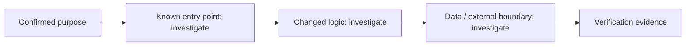

# Change Story — rdux15-project-device-separation

## Confirmed purpose
Desktop remote connection UX: sidebar/composer/settings entries dispatch connection completion via remote-connection-flow contract; settings owns device management; project draft owned by one store owner.

## Route
normal

## Diagram-first path

## What will change

- Not yet verified. Link affected entry points, components, contracts, and data paths after repository investigation.

## What stays protected

- Preserve the Purpose Map non-goals and existing contracts until evidence supports a change.

## Evidence and unknowns

| Claim | Classification | Evidence / next probe |
| --- | --- | --- |
| Change path | unknown | inspect codebase and Atlas cards |
