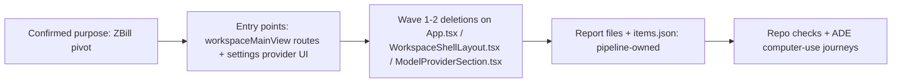

# Change Story — zbill-product-pivot

## Confirmed purpose
Transform ZCode into ZBill: a Windows-first desktop app for creating bill reports.
Agent-chat core kept (3-panel shell); non-billing ZCode features hard-deleted in waves;
bill features expanded (any bill type, item review/edit, report archive, more outputs).
Owner confirmation: ADE chat 2026-11-09, recorded in DT-ZPIVOT-01.

## Route
milestone (unified pipeline; native Spec Kit planning: spec.md / plan.md / tasks.md)

## Diagram-first path

## What will change

- Wave 1 (REQ-107): automations route/branches (App.tsx:881, WorkspaceShellLayout.tsx:1454,
  2159, 2338-2358, 2779-2799), plugin-store route/branches + PluginStorePage + pluginStoreNavigation
  (App.tsx:884-998, WorkspaceShellLayout.tsx:63), marketplace RPCs (App.tsx:844-846),
  coding-plan purchase stack (CodingPlanUpgradeDialog.tsx, CodingPlanEmbeddedWebviewDialog.tsx,
  Detail.tsx:594/:878/:254/:303/:638/:755, ModelProviderSection.tsx:380-609/:849/:1206,
  codingPlanPurchaseAuth.js), dead i18n keys, affected e2e specs.
- Wave 2 (REQ-108): remote-connection-flow, data-sync device management, web/mobile
  remote control, unused provider/store modules; retire ZBILL_PRODUCT flag.
- Wave 3 (REQ-104/105/106): second bill class, item review UI → items.json, report
  archive + document panel browsing + re-export.
- Kept: chat/session runtime, host RPC core, file tree, document panel, provider
  connection config, skillsService discovery (verified independent of marketplace).

## What stays protected

- Purpose-map non-goals (no Google OAuth plugins this milestone; no macOS packaging;
  no new auth/payments; no mobile/web remote control rebuild).
- Provider add/edit/connect + API key management; skillsService discovery contract.
- Repo AGENTS.md architecture rules (hooks-only service access, single state owners,
  no cross-package implementation imports).

## Evidence and unknowns

| Claim | Classification | Evidence / next probe |
| --- | --- | --- |
| Skill discovery independent of marketplace | proven | skillsService.ts:840,1036,1061 digest 7fa9612d |
| Purchase vs provider boundary | proven | Detail.tsx / ModelProviderSection.tsx digests in investigation receipt |
| Automations/plugin-store are route-conditional | proven | App.tsx / WorkspaceShellLayout.tsx digests in investigation receipt |
| Report archive UX shape | assumed (bounded) | maker work resolves directory + panel integration; no purpose conflict |
| Host-side marketplace/purchase handler inventory | unknown (bounded) | task T1 traces host handlers during maker work |
