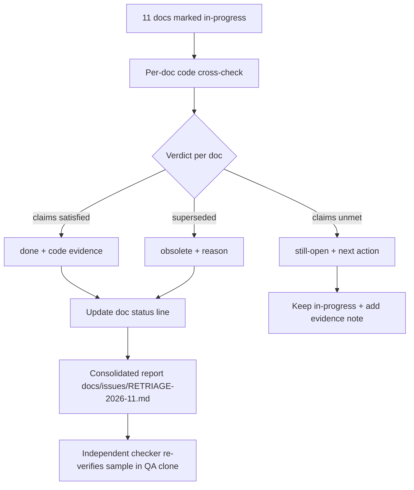

# Shared design view — doc-retriage-2026-11

Renderer: Mermaid (fallback). Limitation: interactive Archify renderer not exercised for this
feature; the diagram is a static, non-validated representation recorded truthfully as a fallback.

