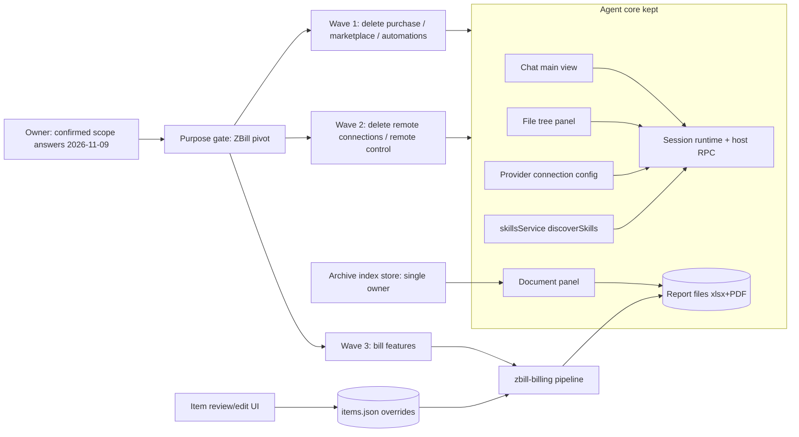

# Design view — zbill-product-pivot (Mermaid fallback)

Source: [design-view.mmd](design-view.mmd)

Limitation: Archify renderer is not installed in this environment; this is a Mermaid
fallback with the same factual content and source links. It is a shared explanation, not
product proof — repo checks and public-behavior verification enforce the actual contract.
